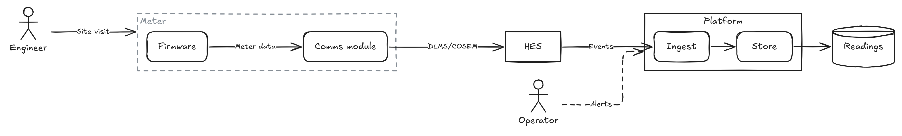

# arch-text

**Write architecture diagrams as text and get laid-out Excalidraw scenes, SVG and PNG.**

arch-text compiles a small text notation into an [Excalidraw](https://excalidraw.com) scene, laid out automatically with [ELK](https://eclipse.dev/elk/), with arrows bound to their shapes so they stay attached when you move things. It exports SVG and PNG headlessly and fully offline, and both keep the scene inside them, so they reopen in Excalidraw for editing. It is the architecture-diagram sibling of [bpmn-text](https://github.com/markbac/bpmn-text).

```archt
title "Smart metering"

boundary Meter
  component Firmware
  component Comms module @comms
  Firmware -> @comms: Meter data

system HES
system Platform
  component Ingest
  component Store
  Ingest -> Store

actor Operator
actor Engineer
datastore Readings

@comms -> HES: DLMS/COSEM
HES -> Ingest: Events
Store -> Readings
Engineer -> Meter: Site visit
Operator ..> Platform: Alerts
```



Elements are `system`, `component`, `actor`, `datastore` and `boundary`, nested to any depth, plus invisible `group`s. Edges are `->`, `<->`, `--` and `..>`, with optional labels, and may be chained. [docs/notation.md](docs/notation.md) has the whole notation, its grammar and every diagnostic. More examples are in [examples/](examples/).

> **Status: full notation, unstyled.** Styling (colours, sketch level, fonts) and icons come next; for now their attributes and directives are accepted and ignored with a warning. See the [plan](https://github.com/markbac/arch-text/issues/1) for the phases.

## Install

Releases are not published yet. To run it from a clone (Node.js 20 or 22):

```bash
git clone https://github.com/markbac/arch-text
cd arch-text
npm ci
npm run build
npx playwright-core install chromium
```

`build` needs no browser. `export` needs Chromium: either Playwright's copy, installed by the last command, or any Chromium or Chrome binary named in `ARCH_TEXT_CHROMIUM`.

## Command line

```bash
node dist/cli.js build diagram.archt -o diagram.excalidraw      # or to stdout without -o
node dist/cli.js build "docs/**/*.archt" -o out/                # several files into a folder
node dist/cli.js export diagram.excalidraw -o diagram.svg       # format from the extension
node dist/cli.js export diagram.excalidraw -f png --scale 2     # writes diagram.png beside it
node dist/cli.js export "out/*.excalidraw" -f png -o out/       # several files into a folder
```

| Option | Command | Meaning |
|---|---|---|
| `-o, --output <path>` | both | Output file, or a folder for several inputs |
| `-f, --format svg\|png` | export | Output format (default: from the `-o` extension, else `svg`) |
| `--scale <n>` | export | PNG pixel ratio (default 1) |
| `--padding <px>` | export | Space around the drawing (default 16) |
| `--no-background` | export | Transparent background |

Exit codes: 0 when everything is fine (warnings allowed), 1 when an input has errors or an export fails, 2 for usage errors. Colours are used on a terminal unless `NO_COLOR` is set.

Export runs Excalidraw's own `exportToSvg` and `exportToBlob` in headless Chromium, against a local page that carries all of Excalidraw's fonts. Any attempt to fetch from outside the machine fails the export, so a missing font can never be swapped silently for a download. The reasons are in [docs/decisions.md](docs/decisions.md).

## Library

```ts
import { build, openExporter, serialise } from 'arch-text';

const { scene, diagnostics } = await build(source); // scene is undefined when there are errors
const exporter = await openExporter(); // starts Chromium once
const svg = await exporter.svg(scene!);
const png = await exporter.png(scene!, { scale: 2 });
await exporter.close();
```

## Diagnostics

Each problem is reported with a code, the line, a caret under the problem and, where there is one, a hint. Errors stop `build` writing output; warnings do not. The codes are listed in [docs/notation.md](docs/notation.md#diagnostics).

```text
meter.archt:19:1: error AT008: Nothing is called "coms".
   |
19 | coms -> HES: DLMS/COSEM
   | ^^^^
   = Did you mean "@comms"?
```

## Development

```bash
npm run lint
npm run typecheck
npm run build          # compiler to dist/, export page to dist/export-page/
npm test               # needs the build and Chromium
npm run test:update    # rewrite test/golden/ after an intended output change
```

The tests compare every example in `examples/` with its golden `.excalidraw` and `.svg` files in `test/golden/`, so any change to layout or output fails until the golden files are updated on purpose. They also open every example in the real Excalidraw editor (built on first run into `dist-test/`), move each shape that has arrows, and check that the arrows stay attached.

## Licence

[MIT](LICENSE)
