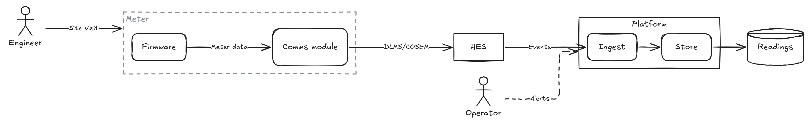
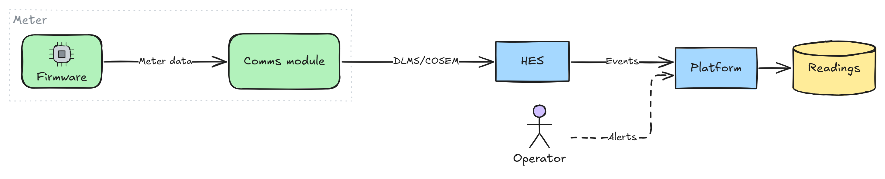

# arch-text

**Write architecture diagrams as text and get laid-out Excalidraw scenes, SVG and PNG.**

arch-text compiles a small text notation into an [Excalidraw](https://excalidraw.com) scene, laid out automatically with [ELK](https://eclipse.dev/elk/), with arrows bound to their shapes so they stay attached when you move things. It exports SVG and PNG headlessly and fully offline, and both keep the scene inside them, so they reopen in Excalidraw for editing. It is the architecture-diagram sibling of [bpmn-text](https://github.com/markbac/bpmn-text).

```archt
title "Smart metering"

boundary Meter
  component Firmware
  component Comms module @comms
  Firmware -> @comms: Meter data

system HES
system Platform
  component Ingest
  component Store
  Ingest -> Store

actor Operator
actor Engineer
datastore Readings

@comms -> HES: DLMS/COSEM
HES -> Ingest: Events
Store -> Readings
Engineer -> Meter: Site visit
Operator ..> Platform: Alerts
```



Elements are `system`, `component`, `actor`, `datastore` and `boundary`, nested to any depth, plus invisible `group`s. Edges are `->`, `<->`, `--` and `..>`, with optional labels, and may be chained. [docs/notation.md](docs/notation.md) has the whole notation, its grammar and every diagnostic. More examples are in [examples/](examples/).

## Styling and icons

```archt
option colors types
use icons ./icons/iot.excalidrawlib

boundary Meter
  component Firmware [icon: chip]
  component Comms module @comms

system HES
system Platform
actor Operator
datastore Readings

Firmware -> @comms: Meter data
@comms -> HES: DLMS/COSEM
HES -> Platform: Events
Platform -> Readings
Operator ..> Platform: Alerts
```



Styling uses Excalidraw's own properties, in four layers, each overriding the one before:

1. options for the whole diagram: `option sketch clean|artist|cartoon`, `option font hand|normal|code` and `option colors none|types`;
1. rules for a kind: `style system [fill: blue]`, `style edge [stroke: gray-4]`;
1. rules for a class, in the order they are written: `style .external [stroke-style: dashed]`, applied to `[class: external]`;
1. attributes on the element or edge: `fill`, `fill-style`, `stroke`, `stroke-width`, `stroke-style`, `rough`, `rounded`, `opacity`, `font`, `font-size`, `text-color` and `text-align`.

Colours are hex, or names from Excalidraw's palette (`blue`, or a shade such as `blue-3`). Icons are items from `.excalidrawlib` libraries or SVG, PNG and JPEG files, drawn inside the shape, in a container's corner, or as the whole node with `icon-only`. [docs/notation.md](docs/notation.md#styling) has the details, and [examples/styling.archt](examples/styling.archt) and [examples/icons.archt](examples/icons.archt) show every layer and placement.

> **Status: complete for the plan's five phases.** See the [plan](https://github.com/markbac/arch-text/issues/1) for what was built and why.

## Install

arch-text is not on npm. Each [release](https://github.com/markbac/arch-text/releases) attaches a tarball to install with npm (Node.js 20 or later):

```bash
npm install -g ./arch-text-0.1.0.tgz
npx playwright-core install chromium    # once, for export and render
```

`build` needs no browser. `export` and `render` need Chromium: either Playwright's copy, installed by the second command, or any Chromium or Chrome binary named in `ARCH_TEXT_CHROMIUM`.

### Docker

The image on GHCR has Node, arch-text and Chromium inside, and needs no network:

```bash
docker run --rm --network none --user "$(id -u):$(id -g)" -v "$PWD:/work" \
  ghcr.io/markbac/arch-text:0.1.0 render "docs/**/*.archt"
```

### In a docs repository

A GitHub Action regenerates a repository's diagrams on every push and checks them on pull requests. [docs/docs-repo.md](docs/docs-repo.md) explains it; [examples/docs-repo](examples/docs-repo/) is a working example.

```yaml
- uses: actions/checkout@v4
- uses: markbac/arch-text@v0.1.0
  with:
    mode: ${{ github.event_name == 'push' && 'commit' || 'check' }}
```

### From a clone

```bash
git clone https://github.com/markbac/arch-text
cd arch-text
npm ci
npm run build
npx playwright-core install chromium
node dist/cli.js --help
```

## Command line

```bash
arch-text build diagram.archt -o diagram.excalidraw       # or to stdout without -o
arch-text build "docs/**/*.archt" -o out/                 # several files into a folder
arch-text export diagram.excalidraw -o diagram.svg        # format from the extension
arch-text export diagram.excalidraw -f png --scale 2      # writes diagram.png beside it
arch-text export "out/*.excalidraw" -f png -o out/        # several files into a folder
arch-text render "docs/**/*.archt"                        # build and export to SVG beside each file
arch-text render "docs/**/*.archt" -f svg,png --check     # fail if any output is out of date
```

`render` does `build` and `export` in one step, writing `<name>.svg` (and any other formats asked for) beside each `.archt` file, and only when its content changed. With `--check` it writes nothing and exits 1 if any output is missing or out of date, which is what CI in a docs repository runs.

| Option | Command | Meaning |
|---|---|---|
| `-o, --output <path>` | build, export | Output file, or a folder for several inputs |
| `-f, --format svg\|png` | export | Output format (default: from the `-o` extension, else `svg`) |
| `-f, --format <list>` | render | Outputs from `svg`, `png` and `excalidraw`, separated by commas (default `svg`) |
| `--check` | render | Report outputs that are missing or out of date, and write nothing |
| `--scale <n>` | export, render | PNG pixel ratio (default 1) |
| `--padding <px>` | export, render | Space around the drawing (default 16) |
| `--no-background` | export, render | Transparent background |
| `--dark` | export, render | Excalidraw's dark mode |

Exit codes: 0 when everything is fine (warnings allowed), 1 when an input has errors, an export fails, or `render --check` finds outputs out of date, 2 for usage errors. Colours are used on a terminal unless `NO_COLOR` is set.

Export runs Excalidraw's own `exportToSvg` and `exportToBlob` in headless Chromium, against a local page that carries all of Excalidraw's fonts. Any attempt to fetch from outside the machine fails the export, so a missing font can never be swapped silently for a download. The reasons are in [docs/decisions.md](docs/decisions.md).

## Library

```ts
import { build, openExporter, serialise } from 'arch-text';

// `file` is where icon libraries and images are found from; scene is undefined when there are errors.
const { scene, diagnostics } = await build(source, { file: 'docs/meter.archt' });
const exporter = await openExporter(); // starts Chromium once
const svg = await exporter.svg(scene!);
const png = await exporter.png(scene!, { scale: 2, dark: true });
await exporter.close();
```

## Diagnostics

Each problem is reported with a code, the line, a caret under the problem and, where there is one, a hint. Errors stop `build` writing output; warnings do not. The codes are listed in [docs/notation.md](docs/notation.md#diagnostics).

```text
meter.archt:19:1: error AT008: Nothing is called "coms".
   |
19 | coms -> HES: DLMS/COSEM
   | ^^^^
   = Did you mean "@comms"?
```

## Development

```bash
npm run lint
npm run typecheck
npm run build          # compiler to dist/, export page to dist/export-page/
npm test               # needs the build and Chromium
npm run test:update    # rewrite test/golden/ after an intended output change
node scripts/font-ranges.mjs   # after upgrading @excalidraw/excalidraw (ADR-007)
docker build -t arch-text:dev . && scripts/docker-check.sh arch-text:dev   # the image, offline
```

The tests compare every example in `examples/` with its golden `.excalidraw` and `.svg` files in `test/golden/`, so any change to layout or output fails until the golden files are updated on purpose. They also open every example in the real Excalidraw editor (built on first run into `dist-test/`), move each shape that has arrows, and check that the arrows stay attached.

Releases are made by pushing a version tag; [docs/releasing.md](docs/releasing.md) has the steps.

## Licence

[MIT](LICENSE)
