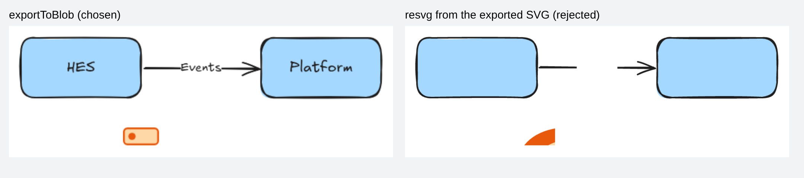
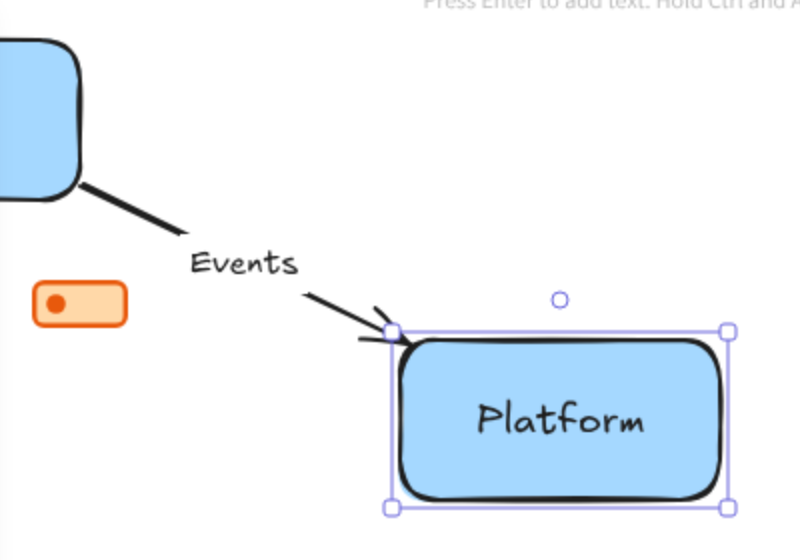

# Decisions

Architecture decision records for arch-text. Each one gives the context, the decision, and the evidence behind it. The first four come from the phase 1 spike ([#2](https://github.com/markbac/arch-text/issues/2)), whose code is in [`spike/`](../spike/README.md) and runs with `npm run all`.

All findings below are for `@excalidraw/excalidraw` 0.18.0, React 19.0.0 and Chromium from Playwright 1.63.0, on Node 22.

## ADR-001: Emit Excalidraw element JSON directly

**Status:** accepted

### Context

The plan allowed using Excalidraw's skeleton API, `convertToExcalidrawElements`, to build elements, if it runs in Node. `build` should not need a browser, and its output must be deterministic so generated files diff cleanly.

### Findings

`spike/node-import.mjs` tries three ways:

1. **Plain import in Node:** fails. The package imports `roughjs/bin/rough` without a file extension, which Node's ESM loader rejects.
1. **Bundled for Node with esbuild:** fails at load time with `window is not defined`.
1. **Bundled, with a hand-written fake DOM (`spike/node-shim.mjs`):** runs, and the bindings are correct (`startBinding`, `endBinding` and `boundElements` all line up). But:
    - text widths come from whatever `measureText` the fake DOM supplies, so it measures nothing real;
    - even with `regenerateIds: false`, label and arrow IDs and every `seed` are random on each run, so output is not deterministic.

### Decision

The emitter writes element JSON itself, against the pinned Excalidraw version. `spike/make-scene.mjs` shows the shape of it: rectangles with bound text labels, an arrow with `startBinding`, `endBinding` and a bound label, and an image element with its file in `files`. IDs and seeds are derived from model IDs.

Every emitted scene is validated by loading it into the real Excalidraw in tests (see ADR-004), which also runs Excalidraw's `restoreElements` to fill in any defaults.

### Consequences

- `build` needs no browser and no fake DOM.
- We own the element schema, so a version bump of `@excalidraw/excalidraw` needs the golden files and the load-in-Excalidraw tests to pass before it lands.

## ADR-002: Measure text in Node from Excalidraw's font files

**Status:** accepted

### Context

Layout needs each label's size before ELK runs, and Node has no canvas. Excalidraw measures text with `canvas.measureText`.

### Findings

`spike/measure.mjs` measures 20 labels at 16, 20 and 28 px in two ways:

- **Node:** fontkit reads the font's `woff2` files from the installed package and sums glyph advances, with kerning.
- **Browser:** `canvas.measureText` in headless Chromium, with the same files declared using Excalidraw's own `unicode-range` values.

All 60 measurements agree to within 0.002 px. The labels include accented letters (`Café`, `Zürich`), digits, punctuation, very narrow and very wide glyphs, and a 28-character label.

Each font family is split into several `woff2` files by Unicode range (seven for Excalifont). The Node code loads every file in the family and, for each character, uses the file that has its glyph, which is what the browser does with `unicode-range`.

### Decision

The sizer measures with fontkit and the font files in `node_modules/@excalidraw/excalidraw/dist/prod/fonts/<Family>/`. Height is `fontSize × lineHeight × lines`, with each family's line height read from the package (1.25 for Excalifont).

### Consequences

- Boxes are sized exactly as Excalidraw will draw their labels, so labels neither overflow nor leave odd gaps.
- `fontkit` becomes a runtime dependency of the compiler.

## ADR-003: Make PNGs with `exportToBlob` in Chromium, not resvg

**Status:** accepted

### Context

The plan left open whether to make PNGs with Excalidraw's `exportToBlob` or by converting the exported SVG with resvg.

### Findings

`spike/export.mjs` makes both from the same scene. It asked for twice the size from each, but `exportToBlob` ignores `appState.exportScale`, so its PNG came out at normal size while resvg's is doubled; the scale has to be passed through `getDimensions` (found in phase 2). The differences below do not depend on size.

- **resvg drops every label.** Excalidraw puts its fonts inside the SVG as `@font-face` rules with base64 data, and resvg does not read them.
- **resvg draws the embedded SVG icon wrongly** (a large clipped shape at the bottom).
- `exportToBlob` matches the editor, and its PNG carries the embedded scene.
- Speed is not a deciding factor: for this scene `exportToBlob` took about 30 ms and resvg about 15 ms, once Chromium was running.

### Decision

PNG comes from `exportToBlob` in the export page. resvg is not a dependency.

### Consequences

`export` needs Chromium for PNG as well as SVG, which it does anyway.

## ADR-004: Offline export through a local page, failing on any outside request

**Status:** accepted

### Context

Export must work with no network access, and must not quietly reach a CDN.

### Findings

`spike/export.mjs` and `spike/exporter.mjs`:

- The export page (`spike/export-page/`) is a Vite bundle that sets `window.EXCALIDRAW_ASSET_PATH` to its own folder before importing `@excalidraw/excalidraw`, and exposes `exportSvg` and `exportPng` on `window`. It passes the scene through `restoreElements` and `restoreAppState` first, as Excalidraw does when opening a file.
- The build copies the package's whole `fonts/` folder beside the page.
- Node serves the page from `127.0.0.1` on a random port. Playwright lets through only that origin and `data:` and `blob:` URLs, and aborts and records everything else.
- With the fonts in place: **zero blocked requests**, and only the one Excalifont file the scene needs is fetched.
- With the fonts folder removed: Excalidraw falls back to `https://esm.sh/@excalidraw/excalidraw@0.18.0/dist/prod/fonts/...`, and the block catches both requests. This is the silent CDN fallback the plan worried about.
- `exportEmbedScene: true` works for both formats: the scene reads back from the SVG and from the PNG with every element ID intact.
- The exported SVG inlines the fonts it uses as base64 `@font-face` rules. Opened on its own in a browser with all requests blocked, it renders correctly and makes no requests.

### Decision

- `export` serves the built page from `127.0.0.1` and blocks every other origin.
- **Any blocked request fails the export** with an error that lists the URLs. A warning is not enough, because the fallback otherwise goes unnoticed.
- The package ships every font folder from `@excalidraw/excalidraw`, copied at build time:

    | Folder | Files | Size | Excalidraw `fontFamily` | Use |
    |---|---|---|---|---|
    | `Excalifont` | 7 | 84 KB | 5 | Hand-drawn (default, `option font hand`) |
    | `Nunito` | 5 | 72 KB | 6 | Normal (`option font normal`) |
    | `ComicShanns` | 4 | 44 KB | 8 | Code (`option font code`) |
    | `Xiaolai` | 209 | 13 MB | (fallback) | Chinese, Japanese and Korean characters in any family |
    | `Lilita` | 2 | 20 KB | 7 | Not used by arch-text |
    | `Virgil` | 1 | 60 KB | 1 | Older hand-drawn font, for opening older scenes |
    | `Cascadia` | 1 | 72 KB | 3 | Older code font |
    | `Liberation` | 1 | 76 KB | 9 | Sans fallback |
    | `Assistant` | 4 | 84 KB | (UI) | Excalidraw's interface font |

    The total is 21 MB, almost all of it `Xiaolai`. Leaving it out would make any CJK label fail the export (through the block above), so it stays in.

### Consequences

- The release tarball and Docker image carry about 21 MB of fonts.
- The page must be served over HTTP, not opened as a `file://` URL, because Excalidraw loads fonts with `fetch`.

## ADR-005: Edges are elbow arrows

**Status:** accepted (phase 3)

### Context

ELK routes edges orthogonally, with bends. In Excalidraw, a plain arrow with bends keeps its bends where they are when a shape it is bound to moves, and only its bound end is recomputed. Once the shape moves past the arrow's first bend, the recomputed end lands away from the shape.

### Findings

`test/editor.test.ts` opens every example in the full Excalidraw editor, moves each shape that has arrows 20 px down and 20 px right with the keyboard, and checks that each bound arrow end is on the moved shape's border. With plain arrows, two arrows in two examples ended 32.5 px off their shapes: both bend about 20 px after leaving the shape. With elbow arrows (`elbowed: true`, and a `fixedPoint` on each binding giving where the end sits on the shape), every arrow in every example stays on its shape, and Excalidraw re-routes it. Excalidraw keeps ELK's route when the file is opened; it re-routes only an arrow whose shape is moved.

### Decision

Every edge is an elbow arrow, with fixed points taken from ELK's end points.

### Consequences

- Moving a shape in Excalidraw re-routes its arrows with Excalidraw's own router, so an edited diagram may route differently from a rebuilt one.
- Excalidraw draws elbow arrows with slightly rounded corners.

## ADR-006: Arrow labels are placed through the arrow's points

**Status:** accepted (phase 3)

### Context

Excalidraw draws an arrow's label at the arrow's middle point, and it moves the label there when it opens a file, whatever position the file gives. ELK, meanwhile, makes room for each label somewhere along its edge, not necessarily in the middle.

### Decision

ELK places labels inline (on the edge). The emitter adds a point to the arrow where ELK put the label, on the line, and pads the shorter side with points on the line until that point is the middle one. In a top-to-bottom layout, ELK reserves room beside vertical edges rather than on them, so there shapes are also kept at least half the widest label's width away from edges.

### Consequences

- Labels land where ELK made room, and `test/build.test.ts` checks that no label overlaps a shape or another label.
- Arrows with labels carry a few extra points on straight stretches; Excalidraw shows them as handles when the arrow is selected.

## Other findings from the spike

These do not need an ADR, but later issues depend on them.

- **Bound arrows follow in the real editor ([#5](https://github.com/markbac/arch-text/issues/5)).** `spike/binding.mjs` loads the hand-written scene into the full Excalidraw editor, drags `Platform` 150 px down with the mouse, and reads the scene back. The arrow stays bound at both ends, its end lies on `Platform`'s left edge, and its label moves with it.

    

- **SVG icons need a width and height ([#6](https://github.com/markbac/arch-text/issues/6)).** An SVG with only a `viewBox` is drawn clipped and too large, in both SVG and PNG exports. Set `UNSIZED=1` when running `spike/make-scene.mjs` to reproduce it. The icon loader must add `width` and `height` from the `viewBox` when they are missing.
- **npm skipped Rollup's native binary ([#9](https://github.com/markbac/arch-text/issues/9)).** In this environment `npm install` left out `@rollup/rollup-linux-x64-gnu`, which Vite needs, and the lockfile had no entry for it ([npm/cli#4828](https://github.com/npm/cli/issues/4828)). The spike lists it under `optionalDependencies` so it installs on Linux and is skipped elsewhere. CI on Windows will need the matching Windows package listed the same way.
- **Timing.** For the two-box scene, once Chromium was running: SVG about 270 ms, PNG about 30 ms. The SVG ran first; I did not measure how much of its time is one-off font loading.
