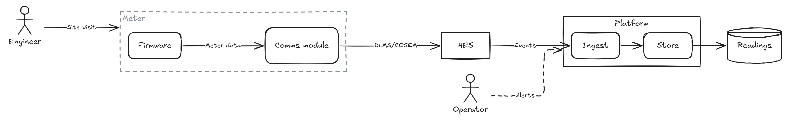
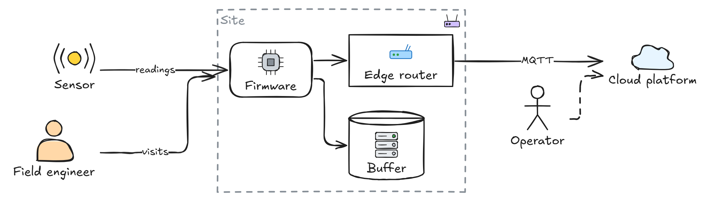

# arch-text notation

An `.archt` file describes an architecture diagram as elements, the elements inside them, and the edges between them. arch-text lays it out; nothing in the file sets a position.

```archt
title "Smart metering"

boundary Meter
  component Firmware
  component Comms module @comms
  Firmware -> @comms: Meter data

system HES
system Platform
  component Ingest
  component Store
  Ingest -> Store

actor Operator
actor Engineer
datastore Readings

@comms -> HES: DLMS/COSEM
HES -> Ingest: Events
Store -> Readings
Engineer -> Meter: Site visit
Operator ..> Platform: Alerts
```



The syntax follows [bpmn-text](https://github.com/markbac/bpmn-text): indentation opens a block, `@id` gives an ID, attributes go in square brackets, and `#` starts a comment.

## Lexical rules

| Item | Rule |
|---|---|
| Encoding | UTF-8. LF and CRLF line endings are both accepted. |
| Indentation | Spaces only (a tab is error AT001). Any deeper indentation than the line before opens a block under that line; a line must line up with the block it belongs to (AT014). Two spaces is the usual style. |
| Comments | `#` to the end of the line, when at the start of the line or after a space, and not inside a string or `[...]`, so `[fill: #1F4E79]` works. |
| Strings | `"..."` with escapes `\"`, `\\` and `\n` (a line break in a label). |
| Bare names | Unquoted text up to the end of the line or the first of `@`, `[`, an edge operator, or (in an edge) `:`. Leading and trailing spaces are trimmed. |
| IDs | `@` followed by a letter or `_`, then letters, digits, `_` or `-`. |
| Blank lines | Ignored. They never end a block. |

Quote a name when it contains one of the characters that end a bare name, or when it starts with a keyword and is used in an edge:

```archt
system "Check -> reserve"     # contains "->"
"system" -> Platform          # starts with a keyword
```

## Elements

| Keyword | Drawn as | May contain |
|---|---|---|
| `system` | Rectangle | Yes |
| `component` | Rounded rectangle | Yes |
| `actor` | Stick figure with the name beneath | No (AT012) |
| `datastore` | Cylinder | No (AT012) |
| `boundary` | Dashed grey rectangle with the name at the top left | Yes |
| `group` | Nothing: its members are laid out together and form one Excalidraw group | Yes, and must (AT016) |

```archt
system Platform @platform [doc: "The data platform"]
  component Ingest
  component Store
```

- The name follows the keyword. Every element needs one except `group`, where it is optional.
- `@id` gives the element an ID; otherwise one is made from the name (`Comms module` becomes `comms-module`, then `comms-module-2` if that is taken). IDs are used in the `.excalidraw` file, so they stay the same from build to build.
- A `system` or `component` with children is drawn sized to them, with its name at the top.
- Containers nest to any depth.

## Edges

| Operator | Meaning | Drawn as |
|---|---|---|
| `->` | Directed | Arrow |
| `<->` | Both ways | Arrow with two heads |
| `--` | Undirected | Line |
| `..>` | Asynchronous or optional | Dashed arrow |

```archt
Web app -> Accounts: SQL
Web app <-> Session cache
Web app -- Payments
Web app ..> Email: async
Browser -> Web app -> Accounts     # a chain: two edges
```

- An edge may have a label after `:`, and attributes after that: `A -> B: HTTPS [doc: "Public API"]`.
- A chain such as `A -> B -> C` makes one edge per step, each with its own operator. A chain cannot have a label (AT015); write labelled edges on their own lines.
- An edge may start or end on a container. It cannot start or end on a group (AT017), which is not drawn, or connect a container with something inside it (AT018, left out).
- An edge from an element to itself is left out (AT010).
- Edges may be written at the top level or inside any block. Where an edge is written changes only how its names are looked up, never the drawing.
- In the `.excalidraw` file, edges are elbow arrows bound to their shapes at both ends, so they re-route and stay attached when shapes are moved.
- An edge that points against the flow, such as a display back to the person who presses its buttons, is laid out as if it ran the other way and drawn with its arrowhead at its target, so it takes the short route instead of looping round the containers in between.
- Labels of edges that run side by side are slid along their lines until they clear each other and the shapes.
- Arrows meet a shape spread across its side. A hub, with four or more arrows on one side, is widened (or, left to right, made taller) to give each arrow a 120 px lane, so it reaches across what it connects to and its arrows drop straight to their ends instead of fanning out side by side.
- `option edges bundle` draws parallel edges as one. See [Directives](#directives).

### How edge ends are found

An end is either `@id`, which matches an element ID exactly, or a name:

1. Names match ignoring case and repeated spaces: `head end` matches `Head  End`.
1. A name is looked up in the block the edge is written in (including the blocks inside it), then in each enclosing block in turn, then in the whole file. The first block where it matches settles it.
1. If that block has more than one match, the edge is ambiguous (AT009): give the one you mean an `@id` and refer to it by that.
1. If nothing matches anywhere, the error (AT008) suggests the closest name.

```archt
boundary Site A
  system Gateway
  system Logger
  Gateway -> Logger       # Site A's Gateway and Logger
boundary Site B
  system Gateway
  system Logger
  Gateway -> Logger       # Site B's
```

## Attributes

Attributes go in square brackets after an element, an edge or a style rule, separated by commas. A flag has no value; `key: value` sets one; further values after a comma belong to the last key: `[class: external, legacy]`. Quote a value that contains a comma or a `]`.

| Attribute | Elements | Edges | Style rules | Meaning |
|---|---|---|---|---|
| `doc: "..."` | Yes | Yes | No | A description. Stored, not drawn. |
| `class: <name>, ...` | Yes | Yes | No | Classes for `style .<name>` rules. |
| `icon: <name or path>`, `icon-only` | Yes | No | Yes | See [Icons](#icons). |
| `fill`, `fill-style`, `rounded`, `opacity`, `text-align` | Yes | No | Yes | See [Styling](#styling). |
| `stroke`, `stroke-width`, `stroke-style`, `rough`, `font`, `font-size`, `text-color` | Yes | Yes | Yes | See [Styling](#styling). |

An attribute where it has no meaning, such as `fill` on an edge or anything but `doc` and `class` on a group, is ignored with warning AT024. Any other attribute is ignored with warning AT013.

## Directives

These go at the top level (AT020 inside a block).

| Statement | Meaning |
|---|---|
| `title "..."` | The diagram's name. |
| `option direction right \| down` | Lay out left to right (the default) or top to bottom. |
| `option sketch clean \| artist \| cartoon` | How hand-drawn lines look: Excalidraw's roughness 0, 1 (the default) or 2. |
| `option font hand \| normal \| code` | The font for every label: Excalifont (the default), Nunito or Comic Shanns, the three in Excalidraw's font picker. |
| `option colors none \| types` | `types` fills each kind of element with its own colour; `none` (the default) fills nothing. `colours` is accepted too. |
| `option edges separate \| bundle` | `bundle` draws edges with the same two ends, operator and look as one arrow, with their labels one under another, as for the wires of one connector. `separate` (the default) draws each edge. |
| `use icons <file.excalidrawlib>` | Load an icon library. See [Icons](#icons). |
| `style <kind or .class> [attrs]` | A style rule. See [Styling](#styling). |

Any other option, or a value an option does not take, is error AT019.

## Styling

```archt
option sketch clean
option colors types

style edge [stroke: gray-4]
style .external [fill: gray-1, stroke-style: dashed]
style .critical [stroke: red, stroke-width: bold]

system Payments [class: external, critical]
system Orders [fill: orange, font: code]
Orders -> Payments: card [stroke: blue]
```


Excalidraw has a fixed set of style properties and no rich text, so arch-text exposes those properties and nothing else. The look of each element and edge is worked out in four layers. Each layer overrides the one before it, property by property:

1. **Options.** Excalidraw's defaults, then `option sketch`, `option font` and `option colors`, then the look of each kind: boundaries are dashed and grey with the title at the top left, components are rounded, and `..>` edges are dashed.
1. **Kind rules.** `style system [...]`, `style component [...]`, `style actor [...]`, `style datastore [...]`, `style boundary [...]`, and `style edge [...]` for every edge. Rules for the same kind apply in source order.
1. **Class rules.** `style .<class> [...]` for each element or edge with that class. Rules apply **in source order**, not in the order the classes are listed on the element: with `[class: external, critical]`, a property set by both `.external` and `.critical` takes the value of whichever rule is written later in the file. Edges take only the edge properties from a class rule, so one class can style both elements and edges.
1. **Attributes** on the element or edge itself.

`style group` and any other selector are error AT025.

### Style attributes

| Attribute | Values | Excalidraw property |
|---|---|---|
| `fill` | A colour (the default is `transparent`) | `backgroundColor` |
| `fill-style` | `solid` (the default), `hachure`, `cross-hatch`, `zigzag` | `fillStyle` |
| `stroke` | A colour | `strokeColor` |
| `stroke-width` | `thin` (1), `bold` (2, the default), `extra-bold` (4), or px from 0.5 to 20 | `strokeWidth` |
| `stroke-style` | `solid`, `dashed`, `dotted` | `strokeStyle` |
| `rough` | `clean`, `artist`, `cartoon`, or 0, 1, 2 | `roughness` |
| `rounded` | A flag; `rounded: no` turns it off (components are rounded by default) | `roundness` |
| `opacity` | 0 to 100 (the default), also `60%` | `opacity`, of the shape, its label and its icon |
| `font` | `hand`, `normal`, `code` | the label's `fontFamily` |
| `font-size` | `small` (16), `medium` (20), `large` (28), `huge` (36), or px from 6 to 200 | the label's `fontSize` |
| `text-color` | A colour | the label's `strokeColor` |
| `text-align` | `left`, `center`, `right` | the label's `textAlign` |

Element labels default to 20 px and edge labels to 16 px. Labels are measured in their own font and size, so boxes, containers and the space ELK leaves for edge labels always fit them.

On an actor, `stroke` and `fill` paint the stick figure (the fill is its head). On a datastore they paint the cylinder. The box that arrows bind to stays invisible.

### Colours

| Form | Example | Meaning |
|---|---|---|
| Hex | `#1F4E79`, `#abc`, `#1f4e7980` | As written (lower case) |
| Name | `blue` | A colour from Excalidraw's palette, in the shade its colour picker uses: the second for `fill`, the fifth for `stroke` and `text-color` |
| Name and shade | `blue-1` to `blue-5` | A shade of that colour, lightest first |
| Special | `transparent` (or `none`), `black`, `white` | Excalidraw's own black is `#1e1e1e` |

The names are `gray` (or `grey`), `red`, `pink`, `grape`, `violet` (or `purple`), `blue`, `cyan`, `teal`, `green`, `yellow`, `orange` and `bronze`. A value that is not a colour is ignored with warning AT023, which lists them.

With `option colors types`, systems are blue, components green, datastores yellow and actors violet, in the second shade (the first for containers, so what they hold stands out). Boundaries and edges are not filled.

### Plain-text labels

A label is one Excalidraw text element, which has one font, size and colour. Markdown or HTML emphasis such as `**bold**`, `_italic_` or `<u>underline</u>` is drawn exactly as typed, so it gives warning AT022. Use `font`, `font-size` or `text-color` instead.

## Icons

```archt
use icons ./icons/iot.excalidrawlib

boundary Site [icon: gateway]
  component Firmware [icon: chip]
  system Edge router [icon: ./icons/router.svg]
system Cloud [icon: cloud, icon-only]
actor Engineer [icon: person]
```



`[icon: ...]` gives an element an icon, either an item from an Excalidraw library or an image file. Icons can also come from style rules: `style .mcu [icon: chip]`.

### Libraries

`use icons <file>` loads an `.excalidrawlib` file. Both versions are read: version 2 (`libraryItems`, as Excalidraw saves today) and version 1 (`library`). Paths are relative to the `.archt` file. Any number of libraries can be loaded.

- `[icon: <name>]` finds a library item by its name, ignoring case and repeated spaces. The first library loaded that has the name wins.
- `[icon: <library>#<n>]` finds the *n*th item of a library by position, where `<library>` is the file name without `.excalidrawlib`: `iot#3`. Items without names, which includes every item in a version 1 library, are found this way.
- Each use of an item is an independent copy, scaled to fit, with its own element and group IDs. Bindings inside the item, such as an arrow between two of its shapes or text bound to a box, point at the copy's own elements.
- Library items carry shapes, lines and text, not images; an item with only images cannot be used.

### Image files

`[icon: ./path/file.svg]` uses an SVG, PNG or JPEG file, relative to the `.archt` file. A value is taken as a path when it contains `/` or `\` or ends in a file extension. The image is embedded in the scene's `files` as a data URL, keyed by a hash of its content, so an image used several times is stored once. Its size comes from the SVG's `viewBox` (or `width` and `height`), or from the PNG or JPEG header, and it keeps its aspect ratio.

SVG icons stay vectors: exported SVGs embed them as SVG, so they stay sharp at any zoom. They are stored as Excalidraw's editor stores them, with a `width` and `height` added from the `viewBox` where missing, which keeps them from being drawn clipped.

### Placement

| Element | Icon box | Where |
|---|---|---|
| `system`, `component`, `datastore` | 40 px | Inside the shape, above the label, with the shape grown to make room |
| Any of those with `icon-only` | 64 px | The icon is the node: no shape is drawn, and the label sits beneath it |
| `actor` | 64 px | In place of the stick figure, with the label beneath |
| `boundary`, and any element holding others | 24 px | In the top-right corner, beside the title |

The node's box, label and icon are one Excalidraw group, so they move together. Arrows always bind to the node's box, which is invisible for `icon-only` nodes and actors, so they stay attached when the node is moved.

`icon-only` without an icon, or on a container or boundary, is ignored with warning AT024.

### Icon diagnostics

A library that cannot be read is error AT026, at its `use` line. An icon that names nothing is error AT027: for a library name, the hint lists the names there are; for a missing image, it lists the images in that folder.

## Grammar

```ebnf
document     = { line } ;
line         = INDENT? , statement , [ comment ] , NL | [ comment ] , NL ;

statement    = element | edge | directive | style ;

element      = kind , [ name ] , [ id ] , [ attrs ] ;     (* name required except for group *)
kind         = "system" | "component" | "actor" | "datastore" | "boundary" | "group" ;
(* An element whose next line is indented further holds that block:
   boundary, system, component and group only, and a group must hold something. *)

edge         = ref , edge_op , ref , { edge_op , ref } , [ ":" , label ] , [ attrs ] ;
edge_op      = "->" | "<->" | "--" | "..>" ;
ref          = id | name ;
(* A chain (more than one edge_op) cannot have a label. *)

directive    = "title" , text
             | "option" , WORD , WORD
             | "use" , WORD , text ;
style        = "style" , ( kind | "edge" | "." , WORD ) , attrs ;   (* not "group" *)
(* Directives and style rules only at the top level. *)

attrs        = "[" , attr , { "," , attr } , "]" ;
attr         = WORD                                       (* a flag *)
             | WORD , ":" , value                         (* key: value *)
             | value ;                                    (* another value for the last key *)
value        = string | bare_value ;

id           = "@" , ( LETTER | "_" ) , { LETTER | DIGIT | "_" | "-" } ;
name         = string | bare_name ;
label        = string | bare_label ;
text         = string | bare_text ;
string       = '"' , { CHAR | "\\" , ( '"' | "\\" | "n" ) } , '"' ;
comment      = "#" , { CHAR } ;                           (* at line start or after a space *)
```

## Diagnostics

Errors stop `build` writing output; warnings do not. Each comes with the line, a caret under the problem and, where there is one, a hint.

| Code | Severity | Meaning |
|---|---|---|
| AT001 | error | Indentation uses a tab |
| AT002 | error | An indented line with no block to belong to |
| AT003 | error | A statement needs a name (an element, `title`, `@id`, an edge end) |
| AT004 | — | No longer reported. It marked features planned for later phases, which now all exist |
| AT005 | error | A line that is not a statement |
| AT006 | error | A string with no closing quote |
| AT007 | error | The same `@id` on two elements |
| AT008 | error | An edge end that names nothing (with the closest name as a hint) |
| AT009 | error | An edge end that matches more than one element in the nearest block that has it |
| AT010 | warning | An edge from an element to itself, which is left out |
| AT011 | error | Text after the end of a statement |
| AT012 | error | Elements indented under an `actor` or `datastore` |
| AT013 | warning | An attribute arch-text does not know, which is ignored |
| AT014 | error | Indentation that lines up with no enclosing block |
| AT015 | error | A chain of edges with a label |
| AT016 | error | A group with nothing in it |
| AT017 | error | An edge to or from a group |
| AT018 | warning | An edge between a container and something inside it, which is left out |
| AT019 | error | An unknown option, or a value an option does not take |
| AT020 | error | `title`, `option`, `use` or `style` inside a block |
| AT021 | error | A `[` with no closing `]` |
| AT022 | warning | Bold, italic or underline markup in a label, which is drawn as typed |
| AT023 | warning | An attribute value the attribute does not take, which is ignored (the hint lists what it takes) |
| AT024 | warning | An attribute where it has no meaning, such as `fill` on an edge or `icon-only` without an icon, which is ignored |
| AT025 | error | A `style` rule for something that cannot be styled, such as `group` |
| AT026 | error | `use` of something other than `icons`, or an icon library that cannot be read |
| AT027 | error | An icon that names no library item (the hint lists them) or no image file (the hint lists the images in that folder) |
