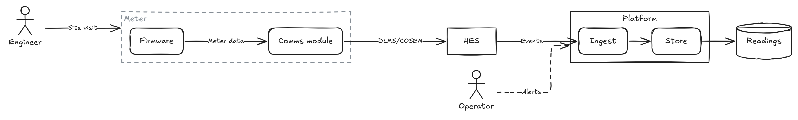

# arch-text notation

An `.archt` file describes an architecture diagram as elements, the elements inside them, and the edges between them. arch-text lays it out; nothing in the file sets a position.

```archt
title "Smart metering"

boundary Meter
  component Firmware
  component Comms module @comms
  Firmware -> @comms: Meter data

system HES
system Platform
  component Ingest
  component Store
  Ingest -> Store

actor Operator
actor Engineer
datastore Readings

@comms -> HES: DLMS/COSEM
HES -> Ingest: Events
Store -> Readings
Engineer -> Meter: Site visit
Operator ..> Platform: Alerts
```



The syntax follows [bpmn-text](https://github.com/markbac/bpmn-text): indentation opens a block, `@id` gives an ID, attributes go in square brackets, and `#` starts a comment.

## Lexical rules

| Item | Rule |
|---|---|
| Encoding | UTF-8. LF and CRLF line endings are both accepted. |
| Indentation | Spaces only (a tab is error AT001). Any deeper indentation than the line before opens a block under that line; a line must line up with the block it belongs to (AT014). Two spaces is the usual style. |
| Comments | `#` to the end of the line, when at the start of the line or after a space, and not inside a string or `[...]`, so `[fill: #1F4E79]` works. |
| Strings | `"..."` with escapes `\"`, `\\` and `\n` (a line break in a label). |
| Bare names | Unquoted text up to the end of the line or the first of `@`, `[`, an edge operator, or (in an edge) `:`. Leading and trailing spaces are trimmed. |
| IDs | `@` followed by a letter or `_`, then letters, digits, `_` or `-`. |
| Blank lines | Ignored. They never end a block. |

Quote a name when it contains one of the characters that end a bare name, or when it starts with a keyword and is used in an edge:

```archt
system "Check -> reserve"     # contains "->"
"system" -> Platform          # starts with a keyword
```

## Elements

| Keyword | Drawn as | May contain |
|---|---|---|
| `system` | Rectangle | Yes |
| `component` | Rounded rectangle | Yes |
| `actor` | Stick figure with the name beneath | No (AT012) |
| `datastore` | Cylinder | No (AT012) |
| `boundary` | Dashed grey rectangle with the name at the top left | Yes |
| `group` | Nothing: its members are laid out together and form one Excalidraw group | Yes, and must (AT016) |

```archt
system Platform @platform [doc: "The data platform"]
  component Ingest
  component Store
```

- The name follows the keyword. Every element needs one except `group`, where it is optional.
- `@id` gives the element an ID; otherwise one is made from the name (`Comms module` becomes `comms-module`, then `comms-module-2` if that is taken). IDs are used in the `.excalidraw` file, so they stay the same from build to build.
- A `system` or `component` with children is drawn sized to them, with its name at the top.
- Containers nest to any depth.

## Edges

| Operator | Meaning | Drawn as |
|---|---|---|
| `->` | Directed | Arrow |
| `<->` | Both ways | Arrow with two heads |
| `--` | Undirected | Line |
| `..>` | Asynchronous or optional | Dashed arrow |

```archt
Web app -> Accounts: SQL
Web app <-> Session cache
Web app -- Payments
Web app ..> Email: async
Browser -> Web app -> Accounts     # a chain: two edges
```

- An edge may have a label after `:`, and attributes after that: `A -> B: HTTPS [doc: "Public API"]`.
- A chain such as `A -> B -> C` makes one edge per step, each with its own operator. A chain cannot have a label (AT015); write labelled edges on their own lines.
- An edge may start or end on a container. It cannot start or end on a group (AT017), which is not drawn, or connect a container with something inside it (AT018, left out).
- An edge from an element to itself is left out (AT010).
- Edges may be written at the top level or inside any block. Where an edge is written changes only how its names are looked up, never the drawing.
- In the `.excalidraw` file, edges are elbow arrows bound to their shapes at both ends, so they re-route and stay attached when shapes are moved.

### How edge ends are found

An end is either `@id`, which matches an element ID exactly, or a name:

1. Names match ignoring case and repeated spaces: `head end` matches `Head  End`.
1. A name is looked up in the block the edge is written in (including the blocks inside it), then in each enclosing block in turn, then in the whole file. The first block where it matches settles it.
1. If that block has more than one match, the edge is ambiguous (AT009): give the one you mean an `@id` and refer to it by that.
1. If nothing matches anywhere, the error (AT008) suggests the closest name.

```archt
boundary Site A
  system Gateway
  system Logger
  Gateway -> Logger       # Site A's Gateway and Logger
boundary Site B
  system Gateway
  system Logger
  Gateway -> Logger       # Site B's
```

## Attributes

Attributes go in square brackets after an element, an edge or a style rule, separated by commas. A flag has no value; `key: value` sets one; further values after a comma belong to the last key: `[class: external, legacy]`.

| Attribute | Applies to | Status |
|---|---|---|
| `doc: "..."` | Elements, edges | Stored; not drawn yet |
| `icon: <name or path>`, `icon-only` | Elements | Phase 4 ([#6](https://github.com/markbac/arch-text/issues/6)); ignored with warning AT004 for now |
| `class`, `fill`, `fill-style`, `stroke`, `stroke-width`, `stroke-style`, `rough`, `rounded`, `opacity`, `font`, `font-size`, `text-color`, `text-align`, `color` | Elements, edges | Phase 4 ([#11](https://github.com/markbac/arch-text/issues/11)); ignored with warning AT004 for now |

Any other attribute is ignored with warning AT013.

## Directives and style rules

These go at the top level (AT020 inside a block).

| Statement | Meaning |
|---|---|
| `title "..."` | The diagram's name. |
| `option direction right` | Lay out left to right (the default). |
| `option direction down` | Lay out top to bottom. |
| `option sketch \| font \| colors <value>` | Phase 4 ([#11](https://github.com/markbac/arch-text/issues/11)); ignored with warning AT004 for now. |
| `use icons <file.excalidrawlib>` | Phase 4 ([#6](https://github.com/markbac/arch-text/issues/6)); ignored with warning AT004 for now. |
| `style <kind or .class> [attrs]` | Phase 4 ([#11](https://github.com/markbac/arch-text/issues/11)); ignored with warning AT004 for now. |

Any other option is error AT019.

## Grammar

```ebnf
document     = { line } ;
line         = INDENT? , statement , [ comment ] , NL | [ comment ] , NL ;

statement    = element | edge | directive | style ;

element      = kind , [ name ] , [ id ] , [ attrs ] ;     (* name required except for group *)
kind         = "system" | "component" | "actor" | "datastore" | "boundary" | "group" ;
(* An element whose next line is indented further holds that block:
   boundary, system, component and group only, and a group must hold something. *)

edge         = ref , edge_op , ref , { edge_op , ref } , [ ":" , label ] , [ attrs ] ;
edge_op      = "->" | "<->" | "--" | "..>" ;
ref          = id | name ;
(* A chain (more than one edge_op) cannot have a label. *)

directive    = "title" , text
             | "option" , WORD , WORD
             | "use" , WORD , text ;
style        = "style" , ( kind | "." , WORD ) , attrs ;
(* Directives and style rules only at the top level. *)

attrs        = "[" , attr , { "," , attr } , "]" ;
attr         = WORD                                       (* a flag *)
             | WORD , ":" , value                         (* key: value *)
             | value ;                                    (* another value for the last key *)
value        = string | bare_value ;

id           = "@" , ( LETTER | "_" ) , { LETTER | DIGIT | "_" | "-" } ;
name         = string | bare_name ;
label        = string | bare_label ;
text         = string | bare_text ;
string       = '"' , { CHAR | "\\" , ( '"' | "\\" | "n" ) } , '"' ;
comment      = "#" , { CHAR } ;                           (* at line start or after a space *)
```

## Diagnostics

Errors stop `build` writing output; warnings do not. Each comes with the line, a caret under the problem and, where there is one, a hint.

| Code | Severity | Meaning |
|---|---|---|
| AT001 | error | Indentation uses a tab |
| AT002 | error | An indented line with no block to belong to |
| AT003 | error | A statement needs a name (an element, `title`, `@id`, an edge end) |
| AT004 | warning | A feature planned for a later phase; ignored for now |
| AT005 | error | A line that is not a statement |
| AT006 | error | A string with no closing quote |
| AT007 | error | The same `@id` on two elements |
| AT008 | error | An edge end that names nothing (with the closest name as a hint) |
| AT009 | error | An edge end that matches more than one element in the nearest block that has it |
| AT010 | warning | An edge from an element to itself, which is left out |
| AT011 | error | Text after the end of a statement |
| AT012 | error | Elements indented under an `actor` or `datastore` |
| AT013 | warning | An attribute arch-text does not know, which is ignored |
| AT014 | error | Indentation that lines up with no enclosing block |
| AT015 | error | A chain of edges with a label |
| AT016 | error | A group with nothing in it |
| AT017 | error | An edge to or from a group |
| AT018 | warning | An edge between a container and something inside it, which is left out |
| AT019 | error | An unknown option, or a value an option does not take |
| AT020 | error | `title`, `option`, `use` or `style` inside a block |
| AT021 | error | A `[` with no closing `]` |
