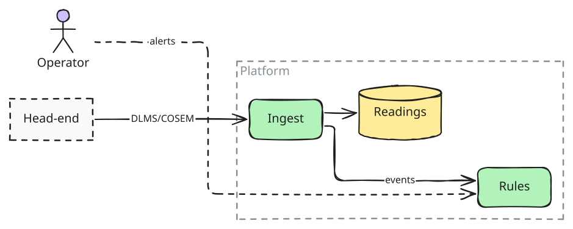

# Metering platform

The platform takes meter readings from the head-end, stores them, and raises alerts.

The diagram's source is [architecture/platform.archt](architecture/platform.archt). Edit that, not the SVG: the [Diagrams workflow](../.github/workflows/diagrams.yml) regenerates the SVG on every push to `main`, and fails a pull request whose SVG is out of date.
